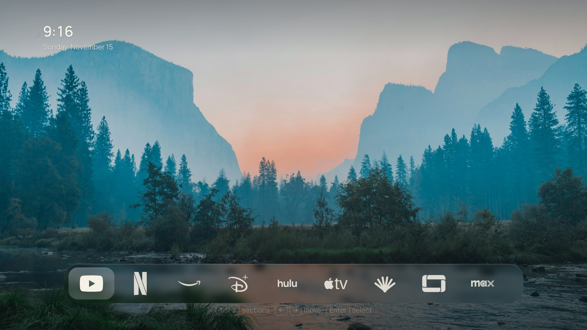

# HA Calm TV

A calmer home screen for Google TV, driven by Home Assistant. A photograph (or a slow looping
video), the time, your apps, and your home: lights, curtains, thermostat, cameras, calendar and
weather, all made for the TV remote.



I built this for one TV, a Google TV Streamer in my living room, and I'm sharing it as a starting
point to build on. Nothing about my home is in the code: each TV reads its rooms, apps and calendars
from a small `calm-tv.json` file, so you can adapt it without touching the app.

**Use it at your own risk.** It replaces the TV's home screen, and controls real devices in your
house. Try it in a browser first, then on the TV when you're ready; the setup guide explains how to
get back to Google's home screen at any time.

It started as a Home Assistant–driven take on [CleanFrame](https://github.com/nthnclrk/CleanFrame),
a lovely home screen for Samsung The Frame.

## Try the interface

You need Node.js 20 or newer.

```sh
git clone https://github.com/NeoCarlos/ha-calm-tv.git
cd ha-calm-tv
npm ci
npm run dev
```

Open [localhost:5173](http://localhost:5173) and use the arrow keys, Enter and Escape, or the mouse.
To see your own home, copy `config/calm-tv.example.json` to `calm-tv.json`, fill in your entities,
and put `VITE_HA_URL=http://<your-ha>:8123` in a `.env.local` file. Then sign in from the Smart Home
screen.

There are four screens: **Apps**, **Smart Home**, **Calendar** and **Weather**. Move between them
with ↑ ↓. Settings is the gear at the end of the app dock.

## Use a coding agent

Most changes are a matter of editing `calm-tv.json`. For anything more, open this repo in a local
coding agent and give it a bounded task:

```text
Read AGENTS.md and the docs folder. Help me adapt HA Calm TV to my home.
My Home Assistant is at <address>. Start with my calm-tv.json and the
browser preview: <describe your rooms, or one change you want>.
Don't install anything on the TV or change its settings yet.
```

## Put it on a TV

Follow [docs/getting-started.md](docs/getting-started.md), then
[docs/tv-setup.md](docs/tv-setup.md): install the app, make it the home screen, point it at Home
Assistant and sign in once. [docs/home-assistant.md](docs/home-assistant.md) covers what Home
Assistant needs.

The [latest release](https://github.com/NeoCarlos/ha-calm-tv/releases/latest) has a ready-made APK,
so you can try it without building anything. It's a debug build; build your own from source for
anything long-term.

## More

- [Configuration](docs/configuration.md): every option in `calm-tv.json`
- [Architecture](docs/architecture.md): how the code fits together
- [Lessons learned](docs/lessons-learned.md): pitfalls already hit and solved
- [Third-party notices](THIRD_PARTY_NOTICES.md): fonts, icons and photos, and their licences

MIT licensed. See [LICENSE](LICENSE).
